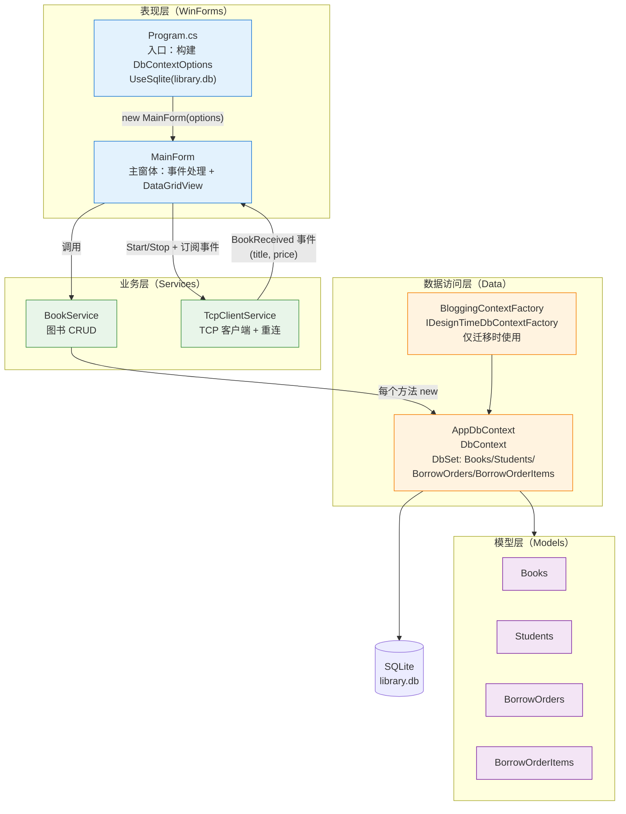
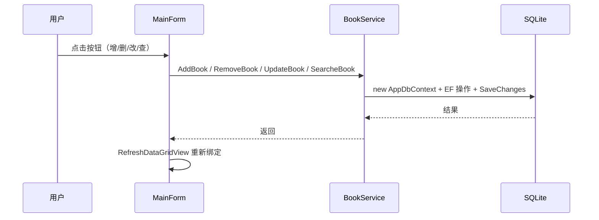
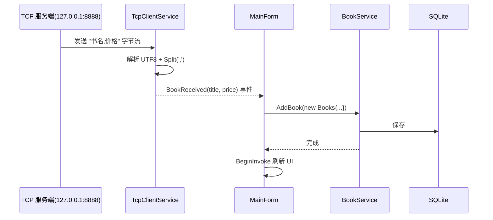

# Bookl_Manager_System 项目架构说明

> 本文档用于向 AI（GPT 等）完整描述当前代码库的架构与数据流。
> 生成时间：2026-11-18，基于 `main` 分支当前代码。

## 1. 项目概述

- **类型**：C# WinForms 桌面应用（单机）
- **目标框架**：`net9.0-windows`
- **ORM**：Entity Framework Core 9.0.11（SQLite 提供程序）
- **数据库**：SQLite，单文件 `library.db`，位于程序输出目录
- **通信**：TCP 客户端，连接本机 `127.0.0.1:8888`
- **命名空间根**：`Bookl_Manager_System`
- **入口**：`Program.Main`

## 2. 技术栈

| 技术 | 用途 |
|------|------|
| .NET 9 / WinForms | 桌面 UI 与运行框架 |
| EF Core 9.0.11 + Sqlite | 数据持久化（Code First + Migrations） |
| `System.Net.Sockets` | TCP 客户端收发 |
| `Task` / `async` / `await` / `CancellationTokenSource` | 异步与取消 |
| 委托与事件（`Action<T>`） | TCP 收到数据后通知 UI |

## 3. 目录结构

```text
Bookl_Manager_System/
├── Program.cs                     # 入口：构建 DbContextOptions，启动 MainForm
├── MainForm.cs / .Designer.cs     # 主窗体：UI + 事件处理
├── Models/
│   ├── Books.cs                   # 图书（含库存字段）
│   ├── Students.cs                # 学生（借阅人）
│   ├── BorrowOrders.cs            # 借阅单
│   └── BorrowOrderItems.cs        # 借阅单明细
├── Services/
│   ├── BookService.cs             # 图书业务（CRUD）
│   └── TcpClientService.cs        # TCP 客户端（收发 + 事件通知）
├── Data/
│   ├── AppDbContext.cs            # EF Core 上下文
│   └── BloggingContextFactory.cs  # 设计时迁移用的 DbContext 工厂
├── Migrations/                    # EF Core 迁移（3 个）
│   ├── 20261112083122_InitialCreate.cs
│   ├── 20261113072215_AddBorrowingTables.cs
│   └── 20261113074327_AdjustBorrowingConstraints.cs
└── docs/
    └── 项目架构说明.md            # 本文档
```

## 4. 分层架构图



## 5. 数据模型（ER 关系）

```mermaid
erDiagram
    Books ||--o{ BorrowOrderItems : "被借"
    Students ||--o{ BorrowOrders : "发起"
    BorrowOrders ||--o{ BorrowOrderItems : "包含"

    Books {
        int Id PK
        string Title
        double Price
        int TotalStock
        int AvailableStock
    }
    Students {
        int Id PK
        string Name
    }
    BorrowOrders {
        int Id PK
        int StudentId FK
        datetime BorrowTime
        datetime DueTime
        datetime ReturnTime "可空"
    }
    BorrowOrderItems {
        int Id PK
        int BorrowOrderId FK
        int BookId FK
        int Quantity
    }
```



## 6. 关键数据流

### 6.1 图书 CRUD 流程



### 6.2 TCP 收书流程



## 7. 各组件职责与要点

### 7.1 Program.cs（入口）
- 计算 `library.db` 路径 = 程序集所在目录 + `library.db`
- 构建 `DbContextOptions<AppDbContext>`，`UseSqlite`
- `Application.Run(new MainForm(contextOptions))`

### 7.2 MainForm（UI）
- 持有 `BookService`（构造注入 options）与 `TcpClientService`
- 订阅 `tcpClientService.BookReceived` 事件
- 所有数据访问都经 `BookService`，UI 不直接碰 DbContext
- TCP 回调用 `BeginInvoke` 切回 UI 线程

### 7.3 BookService（业务层）
- **依赖注入 DbContextOptions**，每个方法内部 `using (new AppDbContext(_dbOptions))`
- 方法：`GetBooks` / `AddBook` / `RemoveBook` / `UpdateBook` / `SearcheBook`
- ⚠️ 残留字段 `private readonly List<Books> bookList = []` 已废弃未使用

### 7.4 TcpClientService（TCP）
- 连接 `127.0.0.1:8888`，后台 `Task` 循环读
- 断线后 `Task.Delay(3000)` 重连
- 协议：UTF8 文本，格式 `title,price`（逗号分隔，两段）
- 通过 `event Action<string, double> BookReceived` 向外通知

### 7.5 AppDbContext（数据访问）
- 4 个 `DbSet`：`Books`、`BorrowOrders`、`Students`、`BorrowOrderItems`
- `OnModelCreating` 配置主键、外键、`IsRequired`、`DeleteBehavior.Restrict`

### 7.6 BloggingContextFactory
- 实现 `IDesignTimeDbContextFactory<AppDbContext>`，仅供 `dotnet ef migrations` 设计时使用，运行时不用

## 8. 已知问题 / 待办（与代码现状一致）

- [ ] 借阅业务逻辑（`BorrowService`）尚未实现，目前只有借阅相关**数据表**，无借还业务代码与 UI
- [ ] `BookService` 中 `bookList` 字段是早期内存版残留，未清理
- [ ] TCP 消息无边界处理（拆包/粘包未处理），一次 `ReadAsync` 假定为一条完整消息
- [ ] 窗体关闭时未显式取消 TCP 后台任务
- [ ] `AddBook` 中价格用 `Convert.ToDouble`，非法输入会抛异常（`UpdateBook` 已改用 `TryParse`）
- [ ] `SearcheBook` 查不到返回 `null`，UI 未判空直接绑定
