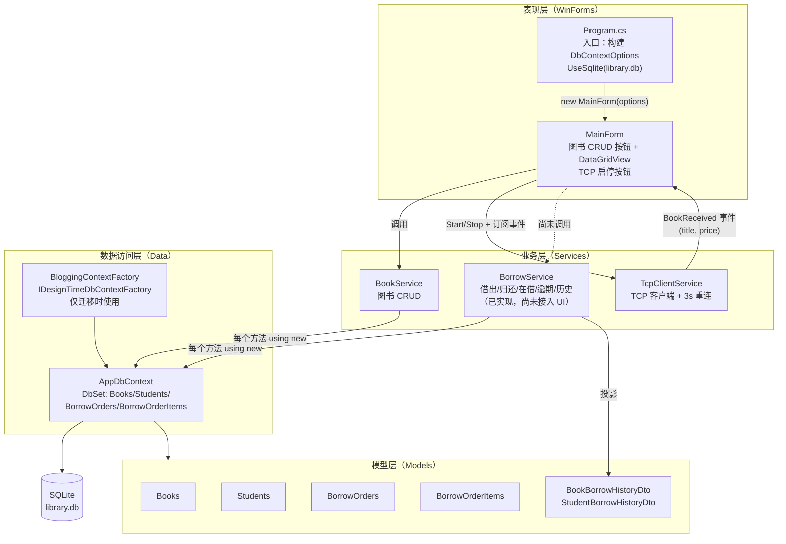
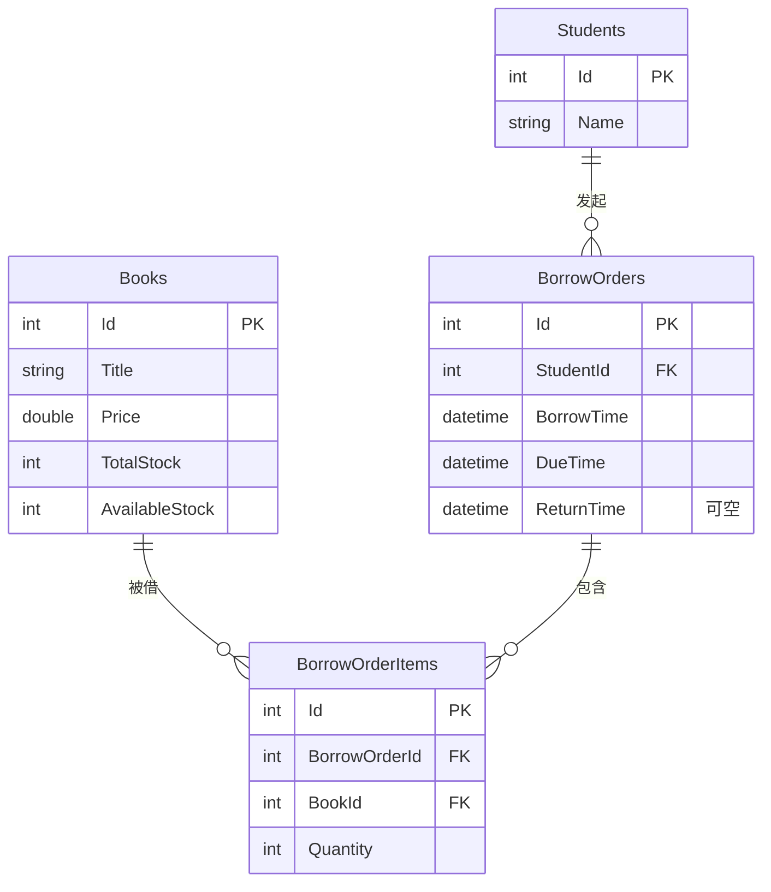
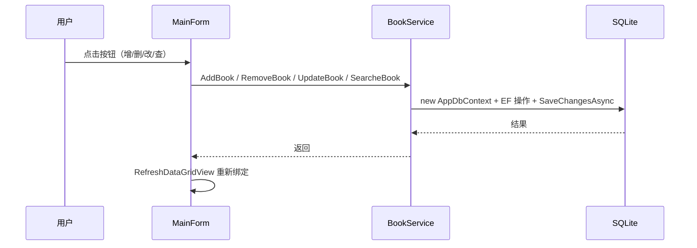
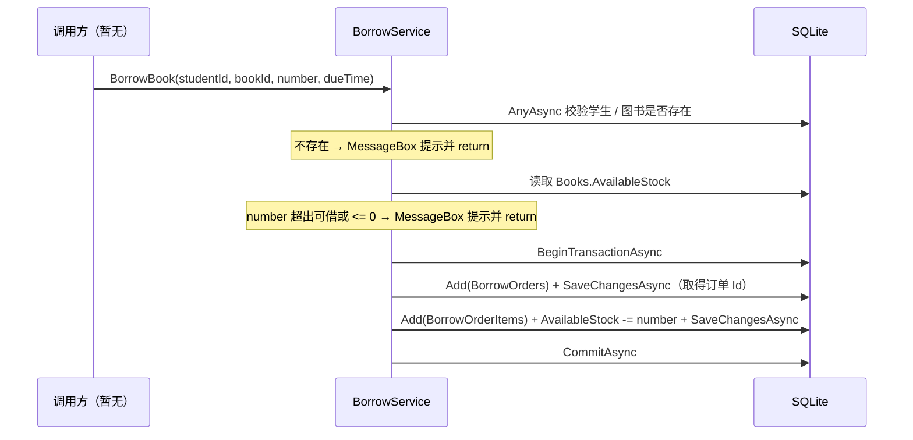
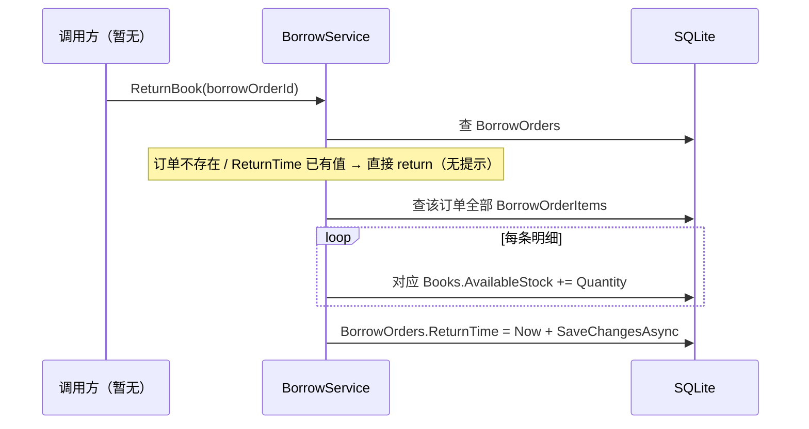

# Bookl_Manager_System 项目架构说明

> 本文档用于向 AI（GPT 等）完整描述当前代码库的架构与数据流。
> 生成时间：2026-11-18；**更新：2026-11-19**（同步 `BorrowService` 与历史查询 DTO）

## 1. 项目概述

- **类型**：C# WinForms 桌面应用（单机）
- **目标框架**：`net9.0-windows`
- **ORM**：Entity Framework Core 9.0.11（SQLite 提供程序，Code First + Migrations）
- **数据库**：SQLite，单文件 `library.db`，位于程序集输出目录
- **通信**：TCP 客户端，连接本机 `127.0.0.1:8888`
- **命名空间根**：`Bookl_Manager_System`
- **入口**：`Program.Main`
- **解决方案**：`Bookl_Manager_System.sln`，仅一个项目 `Bookl_Manager_System.csproj`

## 2. 技术栈

| 技术 | 用途 |
|------|------|
| .NET 9 / WinForms | 桌面 UI 与运行框架 |
| EF Core 9.0.11 + Sqlite | 数据持久化（Code First + Migrations） |
| `System.Net.Sockets` | TCP 客户端收发 |
| `Task` / `async` / `await` / `CancellationTokenSource` | 异步与取消 |
| 委托与事件（`Action<T>`） | TCP 收到数据后通知 UI |
| LINQ `Join` / 匿名类型投影 | 借阅历史的跨表查询 |

## 3. 目录结构

```text
Bookl_Manager_System/
├── Program.cs                     # 入口：构建 DbContextOptions，启动 MainForm
├── MainForm.cs / .Designer.cs     # 主窗体：UI + 事件处理（仅图书 CRUD + TCP 开关）
├── Models/
│   ├── Books.cs                   # 图书（含库存字段 TotalStock / AvailableStock）
│   ├── Students.cs                # 学生（借阅人）
│   ├── BorrowOrders.cs            # 借阅单（表头）
│   ├── BorrowOrderItems.cs        # 借阅单明细（每本书一行）
│   ├── BookBorrowHistoryDto.cs    # 【新增】按图书维度的借阅历史投影（非实体）
│   └── StudentBorrowHistoryDto.cs # 【新增】按学生维度的借阅历史投影（非实体）
├── Services/
│   ├── BookService.cs             # 图书业务（CRUD）
│   ├── BorrowService.cs           # 【新增】借阅业务（借出/归还/在借/逾期/历史）
│   └── TcpClientService.cs        # TCP 客户端（收发 + 事件通知 + 重连）
├── Data/
│   ├── AppDbContext.cs            # EF Core 上下文
│   └── BloggingContextFactory.cs  # 设计时迁移用的 DbContext 工厂
├── Migrations/                    # EF Core 迁移（3 个）
│   ├── 20261112083122_InitialCreate.cs
│   ├── 20261113072215_AddBorrowingTables.cs
│   └── 20261113074327_AdjustBorrowingConstraints.cs
├── Forms/                         # 空目录，暂无内容
├── Properties/                    # 程序集信息 / Resources / Settings
└── docs/
    ├── 项目架构说明.md            # 本文档
    └── 开发计划.md                # 分阶段开发路线图
```

## 4. 分层架构图



要点：`BorrowService` 已具备完整借阅能力，但**没有任何调用方**（`MainForm` 未引用），属于「服务层先行、UI 未接线」状态。

## 5. 数据模型（ER 关系）



说明：
- 所有实体的导航属性（navigation property）均**未定义**，跨表查询靠 LINQ `Join` 显式连接。
- `Books.AvailableStock` 是「可借数量」，借出时减、归还时加；`TotalStock` 目前仅存字段，未被业务代码读写。

## 6. 关键数据流

### 6.1 图书 CRUD 流程



### 6.2 TCP 收书流程


### 6.3 借阅（BorrowService.BorrowBook，尚无 UI 入口）



### 6.4 归还（BorrowService.ReturnBook）



## 7. 各组件职责与要点

### 7.1 Program.cs（入口）
- 计算 `library.db` 路径 = 程序集所在目录 + `library.db`
- 构建 `DbContextOptions<AppDbContext>`，`UseSqlite`
- `Application.Run(new MainForm(contextOptions))`

### 7.2 MainForm（UI）
- 持有 `BookService`（构造注入 options）与 `TcpClientService`（字段直接 `new`）
- 订阅 `tcpClientService.BookReceived` 事件
- 现有控件：`dataGridView1`、`boxTitle`、`boxPrice`、`boxSearch`、`BtnAddBook`、`BtnRemoveBook`、`BtnUpdateBook`、`BtnSearchBook`、`BtnTCPConect`
- 所有图书数据访问都经 `BookService`，UI 不直接碰 DbContext
- TCP 回调用 `BeginInvoke` 切回 UI 线程
- **无借阅相关控件，未引用 `BorrowService`**

### 7.3 BookService（图书业务层）
- **依赖注入 `DbContextOptions<AppDbContext>`**，每个方法内部 `using (var context = new AppDbContext(_dbOptions))`
- 方法（均为 `async`）：`GetBooks` / `AddBook` / `RemoveBook` / `UpdateBook(id, name, price)` / `SearcheBook(id)`
- 早期内存版残留字段 `bookList` **已清理**，类中只剩 `_dbOptions`

### 7.4 BorrowService（借阅业务层，新增）
- 同样依赖注入 `DbContextOptions<AppDbContext>`，每个方法独立 `using` 一个 DbContext
- 方法：

| 方法 | 说明 |
|------|------|
| `BorrowBook(studentId, bookId, number, dueTime)` | 校验学生/图书存在、数量合法 → 事务内建订单 + 明细 + 扣减 `AvailableStock` |
| `ReturnBook(borrowOrderId)` | 幂等（已还则直接返回）→ 按明细回补 `AvailableStock` → 写 `ReturnTime` |
| `GetCurrentBorrowings()` | `ReturnTime == null` 的在借订单 |
| `GetOverdueBorrowings()` | 在借且 `DueTime < Now` 的逾期订单 |
| `GetBookBorrowingHistory(bookId)` | 明细 → 订单 → 学生 三次 `Join`，投影为 `BookBorrowHistoryDto` |
| `GetStudentBorrowingHistory(studentId)` | 学生 → 订单 → 明细 → 图书 四次 `Join`，投影为 `StudentBorrowHistoryDto` |

- 事务使用：`BorrowBook` 中 `BeginTransactionAsync` + 两次 `SaveChangesAsync` + `CommitAsync`
- ⚠️ 校验失败时直接 `MessageBox.Show`（业务层耦合 WinForms UI，见第 8 节）

### 7.5 历史查询 DTO（新增）
- `BookBorrowHistoryDto`：`StudentName` / `BorrowTime` / `DueTime` / `ReturnTime` / `Quantity`
- `StudentBorrowHistoryDto`：`StudentId` / `StudentName` / `BookTitle` / `Quantity` / `BorrowTime` / `DueTime` / `ReturnTime`
- 两者都是**查询投影用的普通类**，不是 EF 实体，不参与 `AppDbContext` 建模

### 7.6 TcpClientService（TCP）
- 连接 `127.0.0.1:8888`，后台 `Task.Run` 循环读
- 断线/连接失败后 `Task.Delay(3000, token)` 重连
- 协议：UTF8 文本，格式 `title,price`（逗号分隔，两段），第二段必须能 `double.TryParse`，否则丢弃该条
- 通过 `event Action<string, double> BookReceived` 向外通知
- `Start()` 幂等（`_cts != null` 直接返回）；`StopAsync()` 取消并等待任务结束；`IsStarted` 反映 `_cts != null`

### 7.7 AppDbContext（数据访问）
- 4 个 `DbSet`：`Books`、`BorrowOrders`、`Students`、`BorrowOrderItems`
- `OnModelCreating` 配置主键、外键、`IsRequired`、`DeleteBehavior.Restrict`
- 未配置任何导航属性，实体之间只有外键 Id

### 7.8 BloggingContextFactory
- 实现 `IDesignTimeDbContextFactory<AppDbContext>`，仅供 `dotnet ef migrations` 设计时使用，运行时不用
- 数据库路径与 `Program.cs` 保持一致（程序集目录 + `library.db`）

## 8. 已知问题 / 待办（与代码现状一致）

### 已修复（相比 11-18 版本）
- [x] ~~`BookService` 中 `bookList` 字段是早期内存版残留~~ —— 已删除
- [x] ~~借阅业务逻辑（`BorrowService`）尚未实现~~ —— 服务层已实现（但见下方「UI 未接线」）

### 待处理
- [ ] **借阅功能无 UI 入口**：`BorrowService` 全局零引用，`MainForm` 没有借阅/归还/历史查询界面，用户无法使用该功能
- [ ] **业务层耦合 UI**：`BorrowService.BorrowBook` 内直接调用 `MessageBox.Show` 提示「学生或者书籍不存在」「借阅数量异常」。业务层应改为返回结果（布尔/结果对象/抛业务异常），由 UI 决定怎么提示
- [ ] **查询结果缺少展示字段**：`BorrowOrders` 没有导航属性，`GetCurrentBorrowings` / `GetOverdueBorrowings` 只返回 `StudentId`，不含学生姓名与书名，直接绑定到表格会显示裸 Id
- [ ] **`ReturnBook` 无失败反馈**：订单不存在或已归还时静默 `return`，调用方无法区分「成功」与「什么都没做」
- [ ] **`Books.TotalStock` 未被使用**：只在模型和数据库中存在，业务代码未读写
- [ ] TCP 消息无边界处理（拆包/粘包未处理），一次 `ReadAsync` 假定为一条完整消息
- [ ] 窗体关闭时未显式取消 TCP 后台任务（`MainForm` 无 `FormClosing` 处理，`StopAsync` 不会被调用）
- [ ] `BtnAddBook_Click` 中价格用 `Convert.ToDouble`，非法输入会抛异常（`BtnUpdateBook_Click` 已改用 `TryParse`）
- [ ] `SearcheBook` 查不到返回 `null`，UI 未判空直接 `new List<Books> { book }` 绑定
- [ ] `RemoveBook` / `UpdateBook` 用 `SingleOrDefault` 后未判空即操作，Id 不存在时会空引用
- [ ] `Forms/` 目录为空，尚未使用
